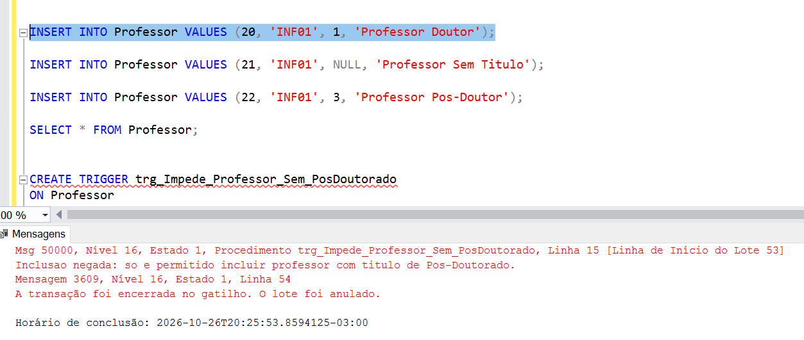
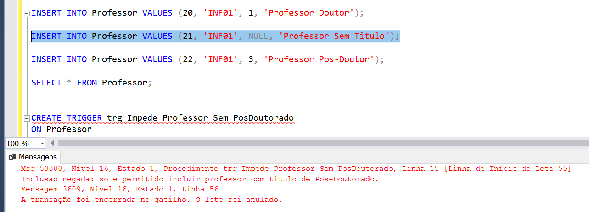
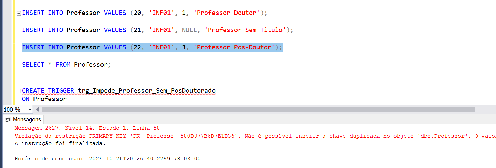
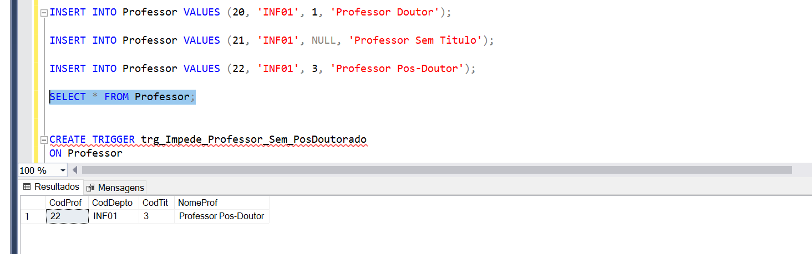

# Exercício de Trigger - Professor

**Enunciado:** Criar trigger que impeça a inclusão de professor sem título de "Pós-Doutorado".

Script da trigger: [trigger_professor.sql](trigger_professor.sql)

## Como funciona

A trigger dispara após cada `INSERT` na tabela `Professor`. Ela verifica a titulação do professor inserido: se for diferente de "Pos-Doutorado", ou se estiver nula, a inclusão é desfeita (`ROLLBACK`) e uma mensagem de erro é exibida.

## Testes

### 1) Professor com título "Doutor" (inclusão negada)

### 2) Professor sem título (inclusão negada)

### 3) Professor com título "Pos-Doutorado" (inclusão permitida)

### 4) Resultado final na tabela Professor

